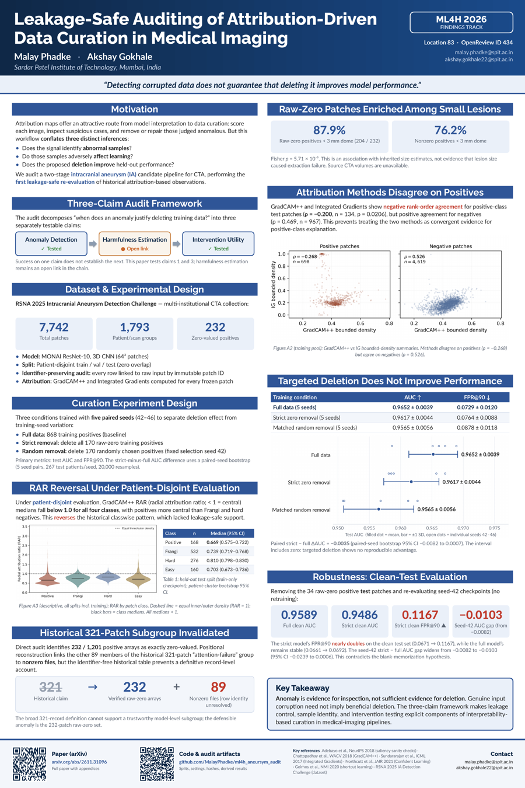

# Leakage-Safe Auditing of Attribution-Driven Data Curation in Medical Imaging

[](https://arxiv.org/abs/2611.31096)

[](poster/ML4H2026_poster.png)
[](paper/ML4H2026_leakage_safe_attribution_audit.pdf)
[](LICENSE)

**Malay Phadke, Akshay Gokhale** · Sardar Patel Institute of Technology, Mumbai, India
*Machine Learning for Health (ML4H) 2026, Findings Track*

> **TL;DR:** Detecting corrupted training data does not guarantee that deleting it improves the model.
> In a CTA intracranial-aneurysm pipeline, we found 232 positive patches that are all-zero arrays (genuine corruption).
> Deleting the 170 in the training set did **not** improve held-out AUC across five paired seeds.
> Anomaly is evidence for inspection, not sufficient evidence for deletion.

<p align="center">
  <a href="poster/ML4H2026_poster.png"></a>
  <br><sub>Click for the full-resolution poster (2880 × 4320).</sub>
</p>

## Resources

| | |
|---|---|
| 📄 Paper (arXiv) | <https://arxiv.org/abs/2611.31096> |
| 📑 Camera-ready PDF | [`paper/ML4H2026_leakage_safe_attribution_audit.pdf`](paper/ML4H2026_leakage_safe_attribution_audit.pdf) |
| 🖼️ Poster | [`poster/ML4H2026_poster.png`](poster/ML4H2026_poster.png) · editable [`.pptx`](poster/ML4H2026_poster.pptx) |
| 🔁 Reproduce all tables (CPU only, no data needed) | `bash reproduce_tables.sh` |

## The question: three claims, tested separately

Attribution-guided curation usually chains three inferences. This repo tests each one on its own:

1. **Identification:** is an anomaly linked, by immutable patch ID, to a direct quality criterion? → *tested*
2. **Harm:** is the anomaly harmful to the model? → *open; not established here*
3. **Utility:** does deleting the anomalous patches beat full-data training and budget-matched random deletion? → *tested*

## Key findings

- **The anomaly is real, but smaller than first claimed.** 232 of 1,201 positive patches are identically zero arrays ("raw-zero"). The historical 321-patch "attention-failure" subgroup does not hold up: only 232 of its records are verified raw-zero.
- **Attribution is central in every class.** Under patient-disjoint evaluation, GradCAM++ radial attribution ratio (RAR) medians are below 1 for all four patch classes (Table 1). This reverses the historical classwise pattern.
- **Raw-zero patches skew towards small lesions:** 87.9% vs 76.2% have dome size < 3 mm (OR 2.28, Fisher p = 5.7 × 10⁻⁵).
- **Attribution methods disagree on positives.** GradCAM++ vs Integrated Gradients gives Spearman ρ = −0.200 on test positives (n = 134), but ρ = 0.469 on negatives (n = 967).
- **Deleting the corruption does not help.** See the table below. A budget-matched random-removal control confirms the result is not an artifact of reduced training size.

### Main result: deletion vs. full data

Test set (n = 1,136; 168 positives). Mean ± sample SD over 5 paired training seeds (42–46).

| Condition | AUC ↑ | FPR@90 ↓ |
|---|---|---|
| Full data | **0.9652 ± 0.0039** | **0.0729 ± 0.0120** |
| Strict zero removal (170 positives) | 0.9617 ± 0.0044 | 0.0764 ± 0.0088 |
| Matched random removal (170, fixed subset) | 0.9565 ± 0.0056 | 0.0878 ± 0.0118 |

- Paired strict − full ΔAUC = **−0.0035** (paired-seed bootstrap 95% CI −0.0082 to 0.0007). The interval includes zero, so targeted deletion shows no reproducible advantage.
- **Clean-test check** (seed 42; the 34 raw-zero test positives removed, n = 1,102):
  - The strict − full AUC gap widens from −0.0082 to −0.0103 (95% CI −0.0239 to 0.0006).
  - The strict model's FPR@90 nearly doubles (0.0671 → 0.1167), while the full model's stays stable (0.0661 → 0.0692).

Per-seed values are in `artifacts/multiseed_clean_test/results_multiseed.csv`, and clean-test metrics in `artifacts/multiseed_clean_test/clean_test_metrics.csv`.

---

## Repository layout

```
audit/                shared code
  paths.py            all paths (env-var overridable)
  core.py             model, dataset, preprocessing, manifest loader, radial attribution maps
  evaluation.py       AUC, FPR@sensitivity, per-negative-class metrics
scripts/              the pipeline, one script per stage (01 → 06)
analysis/             paper tables computed from per-run predictions (CPU only)
configs/condition_plan/   CSV definition of every training condition
data/                 aneurysm_size_estimates_v3.csv (lesion sizes); put patches/ here
artifacts/            frozen split, per-run predictions, result files (~40 MB)
paper/                camera-ready PDF
poster/               ML4H 2026 poster (PNG, preview, editable PPTX)
run_pipeline.sh       run everything
reproduce_tables.sh   regenerate the paper's tables from artifacts/
CITATION.cff          citation metadata (GitHub "Cite this repository")
```

## Setup

```bash
pip install -r requirements.txt     # paper env: Python 3.10, torch 2.7.1 (CUDA 12.8), MONAI 1.3.2
export PYTHONPATH=$PWD              # the shell scripts do this for you
```

| Env var | Default | Meaning |
|---|---|---|
| `AUDIT_DATA_ROOT` | `./data` | must contain `patches/` |
| `AUDIT_OUT_ROOT` | `./outputs` | where pipeline stages write |

## Reproducing the paper

CPU only, no patches needed:

```bash
bash reproduce_tables.sh      # regenerates tables from artifacts/ (on a scratch copy)
```

Full re-run (patches + GPU): `export AUDIT_DATA_ROOT=/path/to/data && bash run_pipeline.sh`. GPU kernels are not bit-identical across hardware, so expect metrics to agree closely but not necessarily to the last digit.

## Dataset

Source: RSNA 2025 Intracranial Aneurysm Detection Challenge (multi-centre CTA). **The CTA volumes and patches are not redistributed**; obtain them from the challenge.

Expected layout: 7,742 patches of 64³ voxels from 1,793 patient/scan groups.

```
data/patches/dataset_v1/
  positive/        1,201   annotated aneurysm
  fast_frangi/     3,576   Frangi-vesselness candidates that are not aneurysms
  negative_hard/   1,787
  negative_easy/   1,178
```

Each file is an `.npz` with key `resized` (64×64×64, HU), named `<SeriesInstanceUID>_<class>_<x>_<y>_<z>.npz`. The UID is the grouping key for splitting.

- **Preprocessing:** clip to [0, 800] HU, Gaussian smoothing (σ = 0.5), per-patch min–max. An all-zero input stays all-zero, which is why "raw-zero" is a valid corruption criterion.
- **Split:** `StratifiedGroupKFold(20)`, seed 42, stratified by class and grouped by patient (folds 0–13 train, 14–16 val, 17–19 test), with no patient overlap.

| Split | Patients | Positive | Frangi | Hard | Easy | Total |
|---|---:|---:|---:|---:|---:|---:|
| Train | 1,256 | 868 | 2,506 | 1,261 | 856 | 5,491 |
| Val | 270 | 165 | 538 | 250 | 162 | 1,115 |
| Test | 267 | 168 | 532 | 276 | 160 | 1,136 |

- **Lesion size:** `data/aneurysm_size_estimates_v3.csv` has one row per positive patch. Dome size is the maximum of the annotated in-plane diameter and the z-extent in mm (NIfTI spacing, DICOM slice positions). For single-slice annotations (84%) it reduces to one slice thickness, so it is coarse. "Small" means < 3 mm.
- **Manifest paths:** `artifacts/manifests/split_manifest.csv` keeps the original absolute paths. The loader re-roots anything after `/patches/` onto `AUDIT_DATA_ROOT`.

## Pipeline (`run_pipeline.sh`)

| Script | Does |
|---|---|
| `01_freeze_split.py` | patient-grouped split, ID lists, SHA256s |
| `02_train_baseline.py` | MONAI ResNet-10 from scratch on train only; checkpoint = best validation FPR@90; test touched once |
| `03_attribution.py` | GradCAM++ (last conv) and Integrated Gradients (zero baseline, 100 trapezoidal steps) for every patch, keyed by `patch_id` |
| `04_audit_gates.py` | ID coverage, raw-zero audit, IG completeness, split-hash and patient-overlap checks |
| `05_train_condition.py` | trains one row of a condition CSV, selecting on validation only |
| `06_summarize_grid.py` | aggregates the grid, picks the best guided condition on validation, writes the follow-up plan |

**Model and training:**
- 64³ input, 20 epochs, Adam (lr 1e-4, weight decay 1e-5), batch 16, unweighted cross-entropy, no augmentation.
- The training set is the 3,460-patch balanced subset recorded in `train_selection.csv`.
- The radial attribution ratio (RAR) is mean outer-sphere attribution divided by mean inner-sphere attribution; RAR < 1 means central.

Each condition in `configs/condition_plan/*.csv` is one training run, with columns `phase, condition_id, mode, score, negative_fraction, direction, seed, …`. Row counts: `phase3_5_conditions` 27, `followup_conditions` 3, `n1_full_condition` 1, `random170_positive_condition` 1, `random170_positive_multiseed` 4, `paired_multiseed_missing` 12. To run a single row, call `scripts/05_train_condition.py --conditions <csv> --condition-index <n>`.

## Experiments and where the evidence is

| Experiment | Defined by | Output in `artifacts/` |
|---|---|---|
| Held-out attribution by class (Table 1) | `03_attribution.py`, `analysis/clean_test_analyses.py` | `multiseed_clean_test/table1_revised.csv` |
| Raw-zero vs small lesions (§4.3) | `analysis/size_enrichment.py` (explicit patch-ID join) | `size_enrichment/` |
| Full vs strict vs random, 5 paired seeds (Table 2, App. F) | `paired_multiseed_missing.csv` + seed-42 runs | `multiseed_clean_test/results_multiseed.csv`, `multiseed_summary.json` |
| Strict − full AUC bootstrap | `analysis/auc_difference_ci.py` | `results/full_vs_strict_auc_bootstrap.json` |
| 5 random 170-positive subsets (App. F) | `random170_positive_multiseed.csv` | `results/random170_positive_multiseed_summary.json` |
| Clean-test robustness (drop 34 raw-zero test positives) | `analysis/clean_test_analyses.py` | `multiseed_clean_test/clean_test_metrics.csv`, `clean_test_bootstrap_summary.csv` |
| GradCAM++ vs IG agreement | `analysis/clean_test_analyses.py` | `multiseed_clean_test/attribution_agreement_test.csv` |
| Curation grid (27 runs) | `phase3_5_conditions.csv` | `results/condition_results.csv`, `grid_summary.json` |

The curation grid contains:
- high-radial negative pruning at 10/25/50/75%;
- strict raw-zero positive pruning;
- random negative pruning (3 seeds × 4 fractions);
- highest-loss and EL2N baselines;
- a low-radial direction control (`b3_radial_low_25`);
- an IG-based pruning (`b3_ig_bounded_high_25`).

The follow-ups are the combined condition and seeds 43 and 44 of `b1_neg_radial_high_10`.

`artifacts/conditions/<id>/` holds each run's summary, training history and test predictions; checkpoints are not shipped. Paired-seed runs are `ms_*`; in the random arm the removed subset is fixed (selection seed 42) and only the training seed varies.

## Not included

- **Patch extraction:** the Frangi extraction code and source CTA volumes are not in this repo. The upstream cause of the zero arrays cannot be localised without them.
- **CAS / recentering experiments:** these need source volumes and a candidate-ID correspondence between patch sets that doesn't exist. They are not reported in the paper.
- **Model checkpoints:** not shipped.

## Citation

If you use this code or build on the audit, please cite:

```bibtex
@misc{phadke2026leakagesafe,
  title         = {Leakage-Safe Auditing of Attribution-Driven Data Curation in Medical Imaging},
  author        = {Phadke, Malay and Gokhale, Akshay},
  year          = {2026},
  eprint        = {2611.31096},
  archivePrefix = {arXiv},
  note          = {Machine Learning for Health (ML4H) 2026, Findings Track},
  url           = {https://arxiv.org/abs/2611.31096}
}
```

## License

Code: [MIT](LICENSE).
The RSNA 2025 challenge data is subject to its own terms and is not redistributed here.

## Contact

Malay Phadke (malay.phadke@spit.ac.in) · Akshay Gokhale (akshay.gokhale22@spit.ac.in)
Questions and issues are welcome via GitHub Issues.
